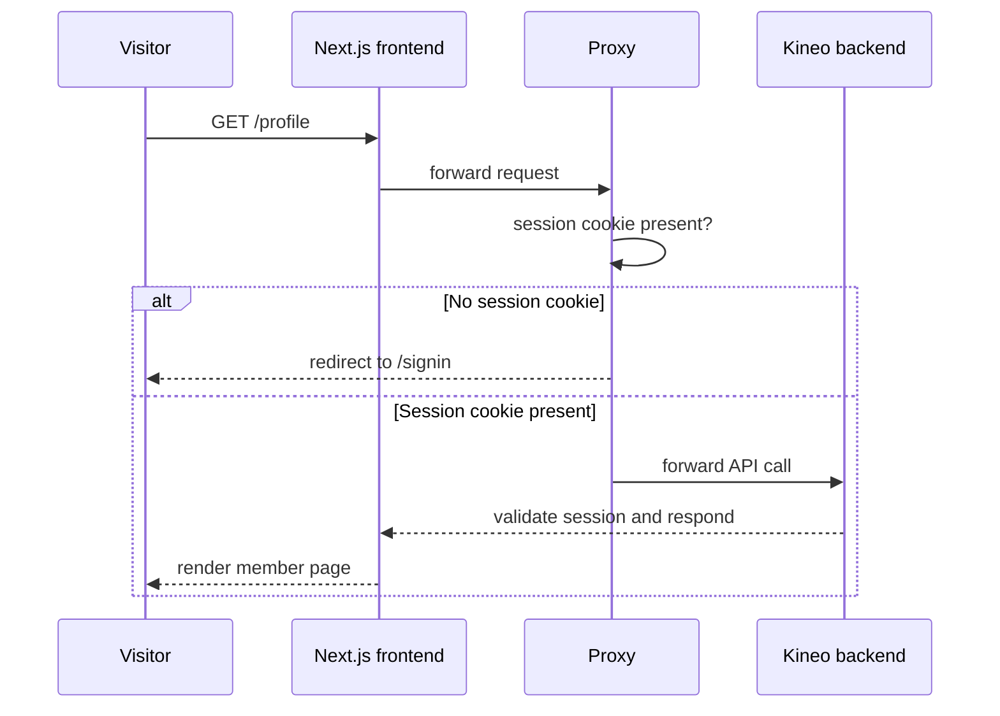

# Authentication

[Documentation index](../README.md) - [Routing](routing.md) - [Services](services.md)

Authentication uses Better-Auth sessions. The backend is the only authentication server: this app forwards the session cookie and relies on the API for validation on every call.

## Two checks

1. **Optimistic check in the proxy.** `src/proxy.ts` looks for a session cookie on protected routes and redirects guests to `/signin`. This skips a round trip for a visitor with no cookie at all.
2. **Authoritative check on the server.** Each protected page resolves the session itself through `lib/server-auth.ts`, which is cached per request so the layout and the page share one read. Real validation happens in the backend on every API call.

> **Note** - The cookie test is not a security boundary on its own. A page that omitted the server-side resolution would still be safe at the API layer, but would render a broken screen instead of redirecting.

## Request flow

## Related flows

- `/verify-email` and `/reset-password` complete flows started by backend emails. The backend rewrites its email links to these pages with `FRONTEND_URL`.
- `/goodbye` is the confirmation screen for account erasure. The emailed token is the proof of identity, and the backend confirms it without requiring a session.
- `/listings` needs an extra server-side session check because its backend endpoints accept anonymous callers; see [Routing](routing.md#the-browse-feed).

## Deployment requirement

The backend rate-limits per client address and this app forwards `X-Forwarded-For` as it receives it. Next fills that header from the socket only when it is absent, so this app must not be reachable directly. Put a reverse proxy in front that overwrites the header with the real client address, or use a platform that does the same. The backend must list that proxy and this app's own address in its `TRUST_PROXY_IPS`. See [Getting started](../guides/getting-started.md).
