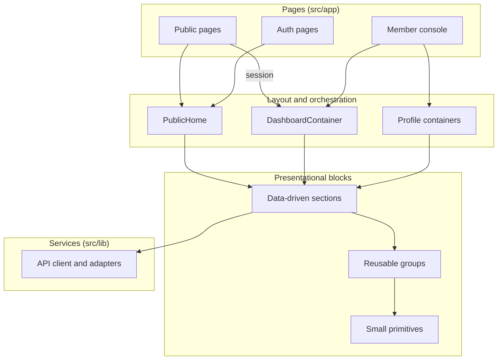

# Architecture overview

[Documentation index](../README.md) - [Routing](routing.md) - [Services](services.md)

The frontend is organized around a page shell, presentational blocks, and a service layer. Pages are thin shells that delegate to layout and orchestration containers; reusable blocks are assembled from small primitives.

## Technology choices

| Area | Choice |
|---|---|
| Framework | Next.js 16, App Router |
| Language | TypeScript 5 |
| Runtime | React 19 |
| Styling | Tailwind CSS 4 |
| Map | MapLibre GL with OSM raster tiles |
| Auth | Better-Auth sessions, backed by the Kineo API |
| Tooling | Bun, Biome |

## Layering

A page never fetches for itself. It resolves the session and the data on the server and hands a client container the result. See [Routing](routing.md) for the page list and [Services](services.md) for the data layer.

## Server-rendered by default

Every data screen resolves its data on the server. The home page chooses between the member dashboard and the marketing content based on the session. The dashboard streams behind a Suspense boundary, so the shell paints immediately and no screen opens with a loading skeleton that a server render would have replaced.

What remains as client components:

- the header, because its links depend on the session;
- the authentication and erasure forms;
- containers that own post-mutation state;
- `Reveal`, the scroll-reveal wrapper on the marketing sections, which needs `IntersectionObserver`.

Everything else in the anonymous landing page ships as server-rendered HTML.

## Performance

- Data is resolved on the server: no client fetch waterfall and no skeleton on a cold load.
- The shell streams on the dynamic home route for instant perceived load.
- Fonts use `next/font`: downloaded at build time and served from this origin, so no request leaves the site at runtime.
- Icons are inline SVG, so there are no bitmap assets.

## Copy ownership

Domain-shaped wording - status labels, retention copy, editorial content - lives in the service layer. Copy belonging to a single screen, such as button labels and form hints, stays in the component that renders it. All error wording is centralized; see [Services](services.md).
